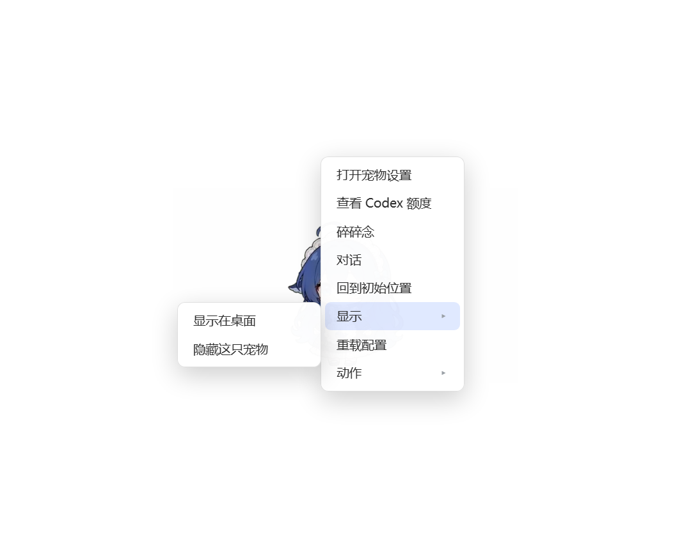

# Codex DSH Pet

将 [PC2005-cloud/dsh-pet](https://github.com/PC2005-cloud/dsh-pet) 适配为 Codex 的本机桌面伴侣：保留原角色、106 段透明动画和拖拽漫游，增加多会话工作状态、宠物聊天、真实账号额度与设置页。

> **来源与归属：本项目是原仓库的 fork，不是原作者的官方 Codex 版本，也不是 OpenAI 官方插件。角色、美术、动画与原版桌宠实现来自上游；本 fork 增加 Codex 宿主及连接层。** 固定基线为上游 [`c6f96350d9307bd6c23bc6ea31974e76a719a8b6`](https://github.com/PC2005-cloud/dsh-pet/commit/c6f96350d9307bd6c23bc6ea31974e76a719a8b6)，版本 0.3.7。保留 [MIT 许可证](LICENSE) 和 [上游原始 README](UPSTREAM-README.md)。



## 下载即用（Windows x64）

从 [Releases](https://github.com/chenshaorong0118/codex-dsh-pet/releases) 下载 Windows 便携 ZIP，解压到固定目录后运行：

1. `Start-Pet.cmd`：启动桌宠。
2. `Open-Settings.cmd`：改名字、大小、多开、自动碎碎念和通知；聊天、查额度、点播动作。
3. `Install-Hooks.cmd`：安装 Codex 事件连接，并备份已有 Hooks。
4. **在 Codex 的 Hooks 审核入口信任新增定义。CLI 可输入 `/hooks`。** 未信任时，桌宠仍可独立使用，但 Codex 不会执行这些事件连接。无需也不应绕过 Hook 信任。

关闭可运行 `Stop-Pet.cmd` 或使用托盘菜单；卸载连接运行 `Uninstall-Hooks.cmd`。不会注册开机启动，不会修改现有 Codex 的模型、登录、notify 或其他 Hooks。

这是完整交互的**独立桌面宠物**，通过官方生命周期 Hooks 跟随 Codex，**不是内置宠物选择器的精灵图替换包**。不需要安装或打开 DSH。用户仍需安装并登录 Codex。

## 做了什么

- 思考、执行、整理、等待确认、完成和明确工具失败的状态联动；中断回到空闲。
- 多会话优先级和子任务跟踪，防止另一会话尚在工作时提前庆祝。
- 通过当前 Codex 登录聊天；自动碎碎念默认关闭。宠物推理采用临时会话和只读沙箱，并关闭 Shell、插件、Apps、浏览器、Computer Use、子代理等能力。
- 通过官方 app-server 查询真实额度窗口；缺少数据时显示不可用，不把“查不到”当作 0。
- 本机设置页：多开、大小、隐藏、原地陪伴、人设、动作点播、对话、额度、可选系统通知。
- 本机访问凭据与 Origin/Host 校验。Hook 只传状态元数据，不传工作提示词、命令、工具参数或输出。
- 便携包自带独立 Node、Electron 和运行依赖；配置及宠物聊天记忆仅在本机保存。

当前人物是蓝发女仆。上游仓库与 npm 0.3.7 的 106 段动画逐一 SHA-256 比对完全一致；旧包描述里的“蓝鲸”没有对应另一套人物素材。

## 从源码构建

需要 Node.js ≥22.12。Windows、Linux、macOS 源码路径沿用上游；本次只实测 Windows x64。

```powershell
git clone https://github.com/chenshaorong0118/codex-dsh-pet.git
cd codex-dsh-pet/dsh-pet
npm ci --legacy-peer-deps --ignore-scripts
npm run codex:build
npm run codex:typecheck
npm run codex:test
node src/codex/control.mjs start
node src/codex/control.mjs settings
node src/codex/control.mjs install-hooks
```

源码运行时会按上游机制准备 Electron；便携包已包含运行时。参数和数据路径详见 [完整说明](CODEX-GUIDE.md)。`CODEX_PET_CODEX` 可指定 Codex 可执行文件；默认优先定位当前桌面版附带的运行时，避免误用旧版残留 CLI。

## 已验证与限制

- 16 项适配器测试、55 项额度／状态回归测试、30 项鼠标命中与输入租约测试通过；Codex 目标 TypeScript 检查通过。
- 8 项浏览器集成检查通过：登录入口、多开保存、移除与人设保留、真实 Hook 到原版状态通道、动作点播、真实额度、真实模型聊天、390px 页面布局。页面 JS 错误为 0。
- 实际 Electron 透明窗口、视频播放、点击／拖拽、温柔放下位置保持、右键菜单及原生鼠标穿透接口往返已检查。合成鼠标离开身体的状态探针未通过，详见 [验证记录](docs/codex/VALIDATION.md)，仍需实机确认跨窗口鼠标路径。
- 1.0.1 修正 Windows Hook 启动命令；正常审核信任后，已实测原生 Codex 事件送达并切换等待／工作状态。新安装仍需用户在 Codex 正常审核信任，没有跳过此流程。
- Codex 没有给 Hooks 提供完整的统一失败事件。明确 `isError`/`is_error` 的工具失败可联动；底层进程崩溃依靠活动超时清理。完成／错误显示 10 秒，无新事件的活动会话 30 分钟后清理。
- 未实测 Linux/macOS、多显示器、休眠恢复、系统通知投递和所有 106 段动画逐段播放。继承上游能力不等于这些场景已经在本 fork 全部验证。

本机数据目录 `data/` 含运行凭据、配置与宠物聊天记忆，**不要上传或分享**。发布包和本仓库排除了这些内容。

## 致谢

- 原项目及美术素材：[PC2005-cloud/dsh-pet](https://github.com/PC2005-cloud/dsh-pet)
- Codex Hooks 文档：[OpenAI 官方说明](https://learn.chatgpt.com/docs/hooks)
- Node.js、Electron 及其依赖的许可保留在便携包内。

保持 MIT 许可。欢迎针对 Codex 适配提交 issue；DSH 原版使用说明见上游。
